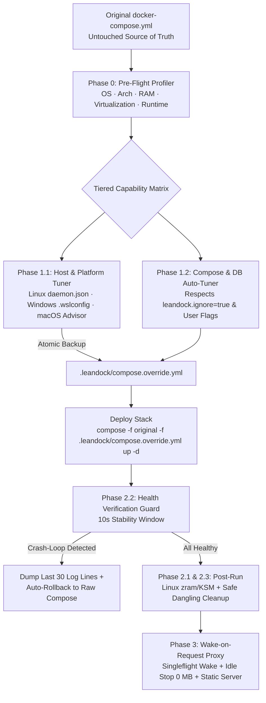

# LeanDock (`leandock`)

**Drop-in, zero-config, non-destructive resource optimizer wrapper for Docker Compose - written in Rust.**

[](https://github.com/pvbang/leandock/actions/workflows/ci.yml)
[](https://github.com/pvbang/leandock/releases)
[](https://www.npmjs.com/package/leandock)
[](https://pypi.org/project/leandock/)
[](https://crates.io/crates/leandock)
[](LICENSE)
[](https://www.rust-lang.org/)

Clone any existing Dockerized project, run `leandock up` instead of `docker compose up -d`, and keep your **exact working application** with dramatically lower RAM, SSD, and background overhead - automatically tailored to your OS, CPU architecture (`x86_64` / `aarch64`), virtualization layer, and hardware limits.

---

## Table of Contents

- [Why LeanDock Exists](#why-leandock-exists)
- [What LeanDock Does - and What It Doesn't Do](#what-leandock-does--and-what-it-doesnt-do)
- [Supported Platforms & Capability Matrix](#supported-platforms--capability-matrix)
- [When to Use (and When NOT to Use) LeanDock](#when-to-use-and-when-not-to-use-leandock)
- [Architecture Overview](#architecture-overview)
- [Installation](#installation)
- [Quickstart (30 Seconds)](#quickstart-30-seconds)
- [Complete Usage Guide](#complete-usage-guide)
  - [1. Inspect Before Touching Anything (`leandock analyze`)](#1-inspect-before-touching-anything-leandock-analyze)
  - [2. Deploy Your Stack (`leandock up` / `leandock down`)](#2-deploy-your-stack-leandock-up--leandock-down)
  - [3. Linux VPS Optimization (KVM, Non-Root, and LXC/OpenVZ)](#3-linux-vps-optimization-kvm-non-root-and-lxcopenvz)
  - [4. Daemonless Podman & Systemd Quadlet Mode](#4-daemonless-podman--systemd-quadlet-mode)
  - [5. Windows (WSL2) & macOS Developer Workflows](#5-windows-wsl2--macos-developer-workflows)
  - [6. Wake-on-Request Scale-to-Zero Proxy (`leandock proxy`)](#6-wake-on-request-scale-to-zero-proxy-leandock-proxy)
  - [7. Opt-In Static Frontend Offloading (`--extract-static`)](#7-opt-in-static-frontend-offloading---extract-static)
  - [8. Opt-In Safe Image Minification (`--minify`)](#8-opt-in-safe-image-minification---minify)
  - [9. Redis / Valkey Data Safety vs. Ephemeral Cache Mode](#9-redis--valkey-data-safety-vs-ephemeral-cache-mode)
  - [10. Excluding Sensitive Services (`leandock.ignore=true`)](#10-excluding-sensitive-services-leandockignoretrue)
  - [11. Monitoring & Reproducible Benchmarks (`status` & `bench`)](#11-monitoring--reproducible-benchmarks-status--bench)
  - [12. Automatic Health Rollback & Full Host Revert (`leandock revert`)](#12-automatic-health-rollback--full-host-revert-leandock-revert)
- [CLI Command Reference](#cli-command-reference)
- [Compose Label Reference](#compose-label-reference)
- [Troubleshooting & FAQ](#troubleshooting--faq)
- [Documentation & Contributing](#documentation--contributing)

---

## Why LeanDock Exists

Docker Compose solved the hardest workflow problem in modern software engineering: you can clone a repository onto a brand-new server or laptop, run `docker compose up -d`, and have your entire stack (databases, APIs, caches, workers, frontend) running cleanly in seconds.

**The painful catch:** Running that convenient stack with default settings wastes massive amounts of RAM, CPU, and disk space - especially on budget VPS instances (1 GB – 8 GB RAM) and developer laptops:

- **On Linux VPS:** Containers are already native Linux processes (no VM), yet default configurations still waste resources heavily: `dockerd` eats ~140–180 MB idle RAM, `docker-proxy` spawns extra userland processes per published port, databases inside containers greedily reserve huge host-proportional caches (for example, MongoDB WiredTiger grabbing 50% of `RAM - 1 GB`), JSON logs grow without bound until the disk fills, dangling build layers eat gigabytes of SSD, modern Linux kernel memory features (`zram`, `KSM`) sit unused, and low-traffic services burn RAM 24/7 while idle.
- **On Windows (WSL2) & macOS:** Developers suffer double overhead: a Linux VM layer (such as `VmmemWSL` holding 50% of host RAM without reclaiming it) stacked on top of greedy default database containers and bloated build caches.

Developers shouldn't have to abandon Docker Compose, maintain fragile native install scripts, or become Linux kernel tuning experts just to run a lean stack.

### The Three Non-Negotiable Oaths

1. **Zero Workflow Friction:** Never force users to abandon Docker, rewrite their `Dockerfile`, or learn a proprietary manifest format. Your existing `docker-compose.yml` remains the single source of truth.
2. **Non-Destructive & 100% Reversible:** LeanDock never edits your original Compose files in place. Every stack optimization is layered via `.leandock/compose.override.yml`, every host-level config edit is atomically snapshotted before touching it, and `leandock revert` restores everything in one command.
3. **Graceful Degradation Over Clever Breakage:** *It is always better to safely skip an optimization with a clear explanation than to risk breaking a running application.* Unsupported OSes, restricted virtualization (LXC/OpenVZ), older kernels, non-root users, and custom shell-wrapper DB commands are skipped cleanly while keeping the stack healthy.

---

## What LeanDock Does - and What It Doesn't Do

LeanDock is built on honest, verifiable systems engineering - zero hype and zero cargo-cult tweaks:

- **What LeanDock DOES:**
  - Probes your OS, CPU architecture (`x86_64` / `aarch64`), RAM, swap, free disk, virtualization type, kernel/systemd version, and installed container runtimes.
  - Dynamically computes safe `mem_limit`, `mem_reservation`, container-level `json-file` log rotation (`10m` x `3`), and database cache caps (`MongoDB`, `PostgreSQL`, `Redis/Valkey`, `MySQL/MariaDB`, `Qdrant`) while preserving user-specified flags and hard low-RAM safety floors.
  - Protects Redis/Valkey persistence by default (`noeviction`, RDB/AOF untouched) unless you explicitly opt into ephemeral cache mode.
  - Safely deep-merges Linux `/etc/docker/daemon.json` (`userland-proxy: false`, `live-restore: true`, log rotation) or exports daemonless Podman Quadlet units (`leandock quadlet`).
  - Analyzes and safely tunes Windows `%UserProfile%\.wslconfig` (`memory`, `swap`, `autoMemoryReclaim=gradual`, `sparseVhd=true`) and warns on slow NTFS bind mounts (`/mnt/c/...`).
  - Configures real Linux `zram` (`zstd` + tuned `sysctl`) and real `KSM` (strictly checking kernel >= 6.1, systemd >= 254, writable sysfs, and installing `MemoryKSM=yes` drop-ins).
  - Verifies every started container during a post-deploy stability window and **automatically rolls back** to your unmodified Compose file if any service crash-loops.
  - Runs an async Hyper v1 **Wake-on-Request reverse proxy** (`leandock proxy`) with singleflight coordination that stops idle containers (`0 MB RAM`) and transparently wakes them on incoming HTTP traffic.
- **What LeanDock DOES NOT do:**
  - It does **not** claim to remove a Linux Docker VM - containers on Linux are already native processes.
  - It does **not** use fragile CRIU checkpoint/restore for container sleeping.
  - It does **not** delete named volumes, bind mounts, or active tagged images during cleanup.
  - It does **not** touch any container labeled `leandock.ignore=true`.

---

## Supported Platforms & Capability Matrix

| Environment / Platform | Tier 1: Compose & DB Auto-Tuner + Log Cap + Cleanup | Tier 2: Wake-on-Request Proxy & Static Offload | Tier 3: Host Runtime & OS Tuning | Tier 4: Linux Kernel (`zram`, `KSM`, `Quadlet`) |
|---|---|---|---|---|
| **Linux VPS (KVM / Bare-metal / Xen / VMware)** *(Ubuntu, Debian, Rocky, Alpine, Arch - x86_64 & ARM64)* | **Full** | **Full** (Unix Socket) | **Full** (`daemon.json`: `userland-proxy=false`, log rotation, `live-restore`) | **Full** (`zram` zstd, `KSM` on kernel >= 6.1 + systemd >= 254, Quadlet) |
| **Linux Container VPS (OpenVZ / Unprivileged LXC)** | **Full** | **Full** (Unix Socket) | **Partial** (`daemon.json` if root) | **Auto-Skipped** cleanly (read-only `/sys` / no `modprobe`) |
| **Windows 10/11 (WSL2 + Docker Desktop / Rancher / Native WSL Docker)** | **Full** | **Full** (CLI/HTTP adapter) | **Full** (safe `.wslconfig` tuning + `/mnt/c` I/O warning) | **Auto-Skipped** cleanly |
| **macOS (Apple Silicon ARM64 & Intel x86_64)** *(Docker Desktop, OrbStack, Colima, Lima)* | **Full** | **Full** (Unix / OrbStack / Colima Socket) | **Partial** (detects active VM runtime & reports VM RAM guidance) | **Auto-Skipped** cleanly |

---

## When to Use (and When NOT to Use) LeanDock

### Ideal Use Cases
- **Full-Stack Web / SaaS / MVP Projects on Small VPS (1 GB – 8 GB RAM):** Frontend + Backend API (FastAPI, Node, Go, Laravel, Rails) + 1–2 Databases (MongoDB, PostgreSQL, Redis, MySQL, Qdrant).
- **Multi-Project VPS Consolidation (Side Projects, Staging, Demos, Portfolios):** Pack 5–10 projects onto a single 4 GB VPS by combining DB memory caps with Wake-on-Request scale-to-zero.
- **AI, Automation, Bot & Internal Tooling Stacks:** On-demand heavy workers (OCR, PDF rendering, media processing, scrapers) or vector databases that sit idle most of the day.
- **Solo Developers & Small Teams Without Dedicated DevOps:** Instant production hygiene (log rotation, OOM bounds, post-build cleanup, zram) in one command.
- **Local Development Laptops (Windows WSL2 / macOS):** Bound local DB caches, optimize `.wslconfig`, and auto-reclaim build cache bloat.

### When NOT to Use LeanDock
- **Large Multi-Node Orchestrators (Kubernetes, Docker Swarm, Nomad):** Those platforms already manage resource scheduling, CNI networking, and autoscaling.
- **Ultra-Low-Latency / High-Throughput Production Systems:** Real-time trading engines, real-time game servers, or heavily saturated primary databases sustaining thousands of writes/sec should rely on manual DBA benchmarking rather than automatic cache caps or Wake-on-Request cold starts.
- **Legacy Pure Windows Native Containers** (`.NET Framework` Windows-kernel containers).
- **Sensitive Individual Services:** Exclude any specific service from **all** LeanDock interventions using `leandock.ignore=true`.

---

## Architecture Overview



---

## Installation

Choose whichever channel fits your machine - **zero compilation required**, every channel runs the exact same native Rust binary.

### Try Instantly Without Installing (Zero-Install)

Already inside a project with a `docker-compose.yml`? Run LeanDock directly in one command:

**Node.js / Web developers (`npx`):**
```bash
npx leandock analyze
npx leandock up
```

**Python / AI / FastAPI developers (`uvx`):**
```bash
uvx leandock analyze
uvx leandock up
```

---

### Install Globally (Recommended for VPS & Daily Use)

**Linux & macOS - 1-Line Installer (`x86_64` & `ARM64`, SHA256 verified):**
```bash
curl -fsSL https://raw.githubusercontent.com/pvbang/leandock/main/scripts/install.sh | bash
```
- Install without `sudo`: `LEANDOCK_INSTALL_DIR="$HOME/.local/bin" curl -fsSL ... | bash`
- Also register as a Docker CLI plugin (`docker leandock up`):
  ```bash
  curl -fsSL https://raw.githubusercontent.com/pvbang/leandock/main/scripts/install.sh | bash -s -- --docker-plugin
  ```

**Windows - PowerShell Installer (SHA256 verified):**
```powershell
irm https://raw.githubusercontent.com/pvbang/leandock/main/scripts/install.ps1 | iex
```

**Homebrew (macOS & Linux):**
```bash
brew install leandock/tap/leandock
```

**Scoop (Windows):**
```powershell
scoop bucket add leandock https://github.com/leandock/scoop-bucket
scoop install leandock
```

**npm / pnpm / Bun (Global):**
```bash
npm install -g leandock
```

**uv / pipx (Python Global Tool):**
```bash
uv tool install leandock
# or: pipx install leandock
```

**Cargo (`cargo-binstall` prebuilt binary or compile from source):**
```bash
# Downloads prebuilt binary in ~2 seconds
cargo binstall leandock

# Or compile from source (Rust 1.78+)
cargo install leandock
```

### Verify Your Environment

Run `leandock doctor` right after installing to confirm your detected OS tier, virtualization type, Compose driver, socket path, and privileges:

```bash
leandock doctor
```

---

## Quickstart (30 Seconds)

From the root of any existing Docker Compose project (or try `examples/fullstack-mongo-api/`):

```bash
# 1. Zero-touch dry run: preview detected tier, DB flags, and estimated RAM savings
leandock analyze

# 2. Deploy with automatic memory budgeting, DB tuning, log caps, health guard & cleanup
leandock up

# 3. Inspect live RAM/CPU, zram compression, KSM deduplication, and Wake states
leandock status

# 4. Roll back every host config snapshot and remove `.leandock/` whenever you want
leandock revert
```

---

## Complete Usage Guide

### 1. Inspect Before Touching Anything (`leandock analyze`)

`leandock analyze` is **strictly zero-touch** - it reads your Compose file and host hardware without creating `.leandock/` or modifying any host configuration:

```bash
# Auto-discovers compose.yaml, compose.yml, docker-compose.yaml, or docker-compose.yml
leandock analyze

# Or point to a specific file and preview Redis ephemeral cache mode
leandock analyze -f docker-compose.prod.yml --ephemeral-cache

# Machine-readable output for CI scripts and dashboards
leandock analyze --format json > analyze.json
```

`--format json` prints a single JSON document (abridged):

```json
{
  "host": { "os": "linux", "virtualization": "lxc", "is_root": false, "...": "..." },
  "detected_tier": 3,
  "tiers": [{ "tier": 1, "capability": "Compose & DB Auto-Tuner + Log Cap + Cleanup", "status": "full", "details": "..." }],
  "skipped_tiers": [{ "tier": 4, "capability": "Linux Kernel (zram, KSM, Quadlet)", "status": "skipped", "details": "Virtualization `lxc` shares host kernel ..." }],
  "budget": { "effective_ram_mb": 2048, "os_reserve_mb": 384, "estimated_savings_mb": 512, "...": "..." },
  "services": [{ "name": "db", "role": "database", "ignored": false, "mem_limit_mb": 512, "mem_reservation_mb": 256, "notes": ["..."], "...": "..." }],
  "host_preview": { "applied": [], "skipped": ["..."], "warnings": [] },
  "warnings": [],
  "errors": []
}
```

`detected_tier` is the highest tier N for which tiers 1..N are all active (`full` or `partial`); `skipped_tiers` lists auto-skipped tiers with the reason in `details`. Service rows never include command lines or environment values, which can hold credentials: `tunes_command` says whether LeanDock tunes the command, and `extra_env_keys` lists only the names of injected variables. `errors` lists anything that could not be collected, such as the host tuning preview.

You can also preview the full `up` pipeline (including Linux kernel `zram`/`KSM` eligibility) with:

```bash
leandock up --dry-run
```

---

### 2. Deploy Your Stack (`leandock up` / `leandock down`)

```bash
# Standard optimized deployment (auto-rollback enabled by default)
leandock up

# Custom compose file, skip kernel tuning, extend health guard stability window to 20s
leandock up -f compose.prod.yml --no-kernel --health-window 20

# Keep dangling build cache (skip post-deploy cleanup)
leandock up --no-cleanup

# Stop and remove containers cleanly
leandock down
```

Under the hood, LeanDock writes `.leandock/compose.override.yml` and runs:
```bash
docker compose -f <your-original-compose.yml> -f .leandock/compose.override.yml up -d
```
Your original `docker-compose.yml`, comments, and `${VAR:-default}` expressions are never modified.

---

### 3. Linux VPS Optimization (KVM, Non-Root, and LXC/OpenVZ)

- **Full KVM / Bare-Metal VPS (with `sudo`):**
  ```bash
  sudo leandock up
  ```
  Enables all 4 tiers:
  - **Tier 1:** Dynamic memory caps, DB cache tuning, container log rotation, post-deploy cleanup.
  - **Tier 3:** Deep-merges `/etc/docker/daemon.json` (`userland-proxy: false`, `live-restore: true`, `json-file` 10m x 3) after atomic backup. Automatically restores backup if `docker.service` reload fails.
  - **Tier 4:** Configures persistent `zram` (`zstd` + `/etc/sysctl.d/99-leandock.conf`) and enables `KSM` (only when Linux kernel >= 6.1, systemd >= 254, and `/sys/kernel/mm/ksm/run` is writable) with `MemoryKSM=yes` drop-ins on `docker.service` and `containerd.service`.

- **Non-Root Linux User (member of `docker` group):**
  ```bash
  leandock up
  ```
  Never crashes or demands `sudo`. Skips Tier 3 (`/etc/docker/daemon.json`) and Tier 4 (`zram`/`KSM`) cleanly with a single notice while keeping Tier 1 (Compose overrides, DB caps, container-level log rotation, cleanup) and Tier 2 (Wake-on-Request proxy) 100% active.

- **Containerized VPS (OpenVZ / Unprivileged LXC):**
  Detected automatically via `/proc/user_beancounters` and `systemd-detect-virt`. Tier 4 kernel tweaks are skipped cleanly without aborting deployment.

---

### 4. Daemonless Podman & Systemd Quadlet Mode

Eliminate `dockerd`'s ~140–180 MB background daemon on Linux VPS by running via Podman or exporting native systemd Quadlet units:

```bash
# Run via podman compose (automatically scans for Docker-only features like docker.sock mounts)
leandock up --engine podman

# Export systemd Quadlet `.container` unit files (uses `podlet` if installed, or built-in generator)
leandock quadlet -f docker-compose.yml -o .leandock/quadlet

# Install rootless user units
mkdir -p ~/.config/containers/systemd
cp .leandock/quadlet/*.container ~/.config/containers/systemd/
systemctl --user daemon-reload
systemctl --user start leandock-api.service
```

---

### 5. Windows (WSL2) & macOS Developer Workflows

- **Windows 10/11 (PowerShell or WSL2):**
  - `leandock up` safely inspects and merges `%UserProfile%\.wslconfig` (backing up the existing file first) with a balanced `memory=` cap (~38% of physical RAM, min 2 GB), `swap=2GB`, `autoMemoryReclaim=gradual`, and `sparseVhd=true`. Run `wsl --shutdown` once afterwards to activate `.wslconfig` changes.
  - If your repository resides on Windows NTFS (`/mnt/c/...` or `C:\...`), LeanDock warns you about severe WSL2 bind-mount I/O overhead and recommends moving the repo into Linux ext4 (`~/projects/...`).
  - `leandock proxy` automatically uses LeanDock's cross-platform async CLI adapter (`docker` / `podman`) on Windows with zero Named Pipe hacks.

- **macOS (Apple Silicon ARM64 & Intel x86_64):**
  - Automatically discovers Unix sockets for **OrbStack**, **Colima**, **Lima**, and **Docker Desktop**.
  - Budgets container limits against the detected Linux VM memory allocation (instead of over-allocating against host RAM) and reports actionable VM memory guidance without modifying macOS internals.

---

### 6. Wake-on-Request Scale-to-Zero Proxy (`leandock proxy`)

Sleep low-traffic apps, staging environments, and internal tools down to **0 MB RAM** after an idle window and wake them automatically on the first incoming HTTP request. Concurrent requests are coalesced via **singleflight** so 50 simultaneous requests trigger exactly one container start.

**Step 1 - Label services in your `docker-compose.yml`:**
```yaml
services:
  staging-app:
    image: myorg/staging-app:latest
    ports:
      - "127.0.0.1:13000:3000"
    labels:
      leandock.idle.enable: "true"
      leandock.idle.timeout: "10m"
      leandock.idle.listen_port: "8081"
      leandock.idle.target_port: "13000"
      leandock.idle.wake_timeout: "30s"
```

**Step 2 - Start your stack and launch the proxy:**
```bash
leandock up
leandock proxy
```

**Manual port mapping (without editing labels):**
```bash
leandock proxy --port-map staging-app:8081:13000:10m
```

**Install as a background systemd service on Linux:**
```bash
leandock proxy --install-service
systemctl --user daemon-reload && systemctl --user enable --now leandock-proxy.service
```
*(Backed up transactionally - `leandock revert` stops and removes the service automatically.)*

See [`examples/wake-on-request-demo/docker-compose.yml`](examples/wake-on-request-demo/docker-compose.yml) for a runnable example.

---

### 7. Opt-In Static Frontend Offloading (`--extract-static`)

Replace redundant Nginx/Apache frontend containers with LeanDock's built-in Rust gzip + SPA static server:

```yaml
services:
  frontend:
    image: myorg/web-frontend:latest
    ports:
      - "8080:80"
    labels:
      leandock.static_dir: "/usr/share/nginx/html"
      leandock.spa: "true"
```

```bash
# Extracts static assets into .leandock/static/frontend/ and disables the frontend container
leandock up --extract-static

# Serve the extracted static files (alongside any Wake-on-Request routes)
leandock proxy
```

If extraction fails or produces an empty directory, LeanDock automatically falls back to running your original frontend container.

---

### 8. Opt-In Safe Image Minification (`--minify`)

Requires [SlimToolkit (`slim`)](https://github.com/slimtoolkit/slim) on `PATH`:

```bash
leandock up --minify
```

LeanDock only minifies eligible non-database, non-ignored application images, boots each minified image in an isolated container to verify startup stability, and automatically falls back to the original image if verification fails.

---

### 9. Redis / Valkey Data Safety vs. Ephemeral Cache Mode

- **Default Mode (Persistence-Safe):** LeanDock **never** silently injects `--save ""` or `allkeys-lru` on Redis or Valkey, because doing so would silently destroy persistent background job queues (BullMQ, Sidekiq, Celery). By default, LeanDock only caps `--maxmemory <val>mb` with `noeviction` and leaves RDB/AOF intact.
- **Ephemeral Cache Mode (Explicit Opt-In):** Enable LRU eviction and disable disk snapshots only when you explicitly intend Redis/Valkey to act as a pure disposable cache - either per-service via label or globally via flag:
  ```yaml
  services:
    cache:
      image: valkey/valkey:8-alpine
      labels:
        leandock.redis.ephemeral: "true"
  ```
  or:
  ```bash
  leandock up --ephemeral-cache
  ```

---

### 10. Excluding Sensitive Services (`leandock.ignore=true`)

Protect any critical service from **all** LeanDock memory caps, DB flags, log overrides, static offload, minification, and proxy discovery. Both YAML mapping and string-array label syntaxes are supported:

```yaml
services:
  billing-ledger:
    image: ghcr.io/acme/billing:1.4
    labels:
      leandock.ignore: "true"
```
```yaml
services:
  legacy-db:
    image: postgres:16
    labels:
      - "leandock.ignore=true"
```

---

### 11. Monitoring & Reproducible Benchmarks (`status` & `bench`)

**Live Stack Telemetry:**
```bash
leandock status

# Machine-readable JSON
leandock status --format json
```
Displays per-container state, CPU %, RAM usage, Wake-on-Request state (`Always-On`, `Active`, or `Sleeping (0 MB)`), plus live Linux `zram` compression ratio and `KSM` deduplicated RAM.

With `--format json`:

```json
{
  "containers": [
    {
      "name": "api", "state": "running", "idle_mode": "Wake Proxy: Active",
      "cpu_percent": 1.25, "mem_used_mb": 48.0, "mem_limit_mb": 256.0,
      "cpu_text": "1.25%", "mem_text": "48MiB / 256MiB"
    }
  ],
  "kernel": {
    "zram_active": true, "zram_orig_data_mb": 300.0, "zram_compr_data_mb": 100.0, "zram_ratio": 3.0,
    "ksm_active": true, "ksm_pages_sharing": 2560, "ksm_saved_mb": 10.0
  },
  "errors": []
}
```

CPU and memory are numbers (MiB), with the runtime's own text kept in `cpu_text` and `mem_text`; a number is `null` if that text could not be parsed. If the container runtime cannot be queried, `containers` is empty and `errors` says why.

**Reproducible Before vs. After Benchmarks:**
```bash
# Terminal table
leandock bench --settle-secs 15

# GitHub-ready Markdown table
leandock bench --format markdown --settle-secs 15

# Machine-readable JSON
leandock bench --format json --settle-secs 15 > bench.json
```
See [`docs/BENCHMARKS.md`](docs/BENCHMARKS.md) for methodology details.

---

### 12. Automatic Health Rollback & Full Host Revert (`leandock revert`)

- **Post-Deploy Health Guard (Automatic):** After `leandock up`, LeanDock monitors all containers for 10 seconds (`--health-window`). If any container enters `restarting`, `unhealthy`, or exits non-zero, LeanDock dumps the last 30 lines of logs and automatically relaunches your untouched original Compose file (disable with `--auto-rollback=false`).
- **One-Command Full Revert:**
  ```bash
  # Revert the most recent host snapshot (daemon.json, sysctl, zram, KSM, .wslconfig, proxy unit) + remove .leandock/
  leandock revert

  # Revert ALL historical backup snapshots
  leandock revert --all
  ```
  Backups are stored atomically in `/var/lib/leandock/backups/<timestamp>/` (Linux root) or `~/.leandock/backups/<timestamp>/` (non-root / Windows / macOS).

---

## CLI Command Reference

| Command | Flags & Defaults | Description |
|---|---|---|
| `leandock analyze` | `-f, --file <PATH>`, `--ephemeral-cache`, `--format text\|json` (default `text`) | Strictly zero-touch dry run showing hardware/OS tier, ignored services, proposed DB/memory flags, and estimated RAM savings. |
| `leandock up` | `-f <PATH>`, `--engine docker\|podman`, `--no-kernel`, `--no-cleanup`, `--minify`, `--extract-static`, `--ephemeral-cache`, `--auto-rollback <bool>` (default `true`), `--health-window <SECS>` (default `10`), `--dry-run` | Generates `.leandock/compose.override.yml`, applies supported host/kernel tuning, deploys stack, verifies health with auto-rollback, and prunes dangling layers/cache. |
| `leandock down` | `-f <PATH>`, `--engine docker\|podman` | Stops and removes the Compose stack cleanly. |
| `leandock proxy` | `--port-map <svc:listen:target[:timeout]>`, `--install-service` | Runs the cross-platform Hyper v1 Wake-on-Request reverse proxy & static server (or installs `leandock-proxy.service` on Linux). |
| `leandock quadlet` | `-f <PATH>`, `-o, --output <DIR>` (default `.leandock/quadlet`) | Exports daemonless systemd Quadlet `.container` units for Linux Podman. |
| `leandock status` | `--format text\|json` (default `text`) | Live container RAM/CPU, `zram` compression stats, `KSM` deduplicated RAM, and Wake-on-Request Active/Sleeping states. |
| `leandock bench` | `-f <PATH>`, `--format table\|markdown\|json` (default `table`), `--settle-secs <SECS>` (default `8`) | Captures reproducible Before vs. After resource metrics (RAM, Swap/zram, Disk, Processes, Startup ms). |
| `leandock revert` | `--all` | Restores backed-up host configs, tears down live zram/KSM/proxy unit if applied, reloads services, and removes `.leandock/`. |
| `leandock doctor` | - | Full cross-platform environment diagnostic (OS tier, virtualization, kernel/systemd, sockets, helpers, permissions). |

---

## Compose Label Reference

All labels support both YAML mapping (`key: "value"`) and string-array (`"key=value"`) formats:

| Label | Example Value | Behavior |
|---|---|---|
| `leandock.ignore` | `"true"` | **Escape hatch:** excludes the service from ALL LeanDock memory caps, DB tuning, static offload, minification, and proxy management. |
| `leandock.redis.ephemeral` | `"true"` | Opt-in ephemeral cache tuning for Redis/Valkey (`--maxmemory-policy allkeys-lru --save ""`). Default preserves persistence (`noeviction`). |
| `leandock.static_dir` | `"/usr/share/nginx/html"` | Marks a frontend container's static build output for opt-in `--extract-static` offloading. |
| `leandock.static_port` | `"8080"` | Override listen port for the built-in Rust static server (defaults to first published host port). |
| `leandock.spa` | `"true"` | Enables SPA fallback (`index.html`) when serving extracted static frontends. |
| `leandock.idle.enable` | `"true"` | Enables Wake-on-Request (Scale-to-Zero) management by `leandock proxy`. |
| `leandock.idle.timeout` | `"10m"` | Inactivity window before gracefully stopping the container (`0 MB RAM`). |
| `leandock.idle.listen_port` | `"8080"` | Public port the LeanDock proxy listens on for this service. |
| `leandock.idle.target_host` | `"127.0.0.1"` | Upstream host address (defaults to `127.0.0.1`). |
| `leandock.idle.target_port` | `"3000"` | Upstream port the proxy forwards traffic to once the container is awake. |
| `leandock.idle.wake_timeout` | `"30s"` | Maximum time to wait for target TCP port readiness before returning HTTP `503` with `Retry-After: 5`. |

---

## Troubleshooting & FAQ

- **Why did LeanDock skip my database command tuning?**
  If your database service uses a shell-wrapper `command:` (e.g., `sh -c "..."`, or pipes/`&&`/`;`), LeanDock intentionally skips injecting DB flags and prints a warning rather than risking shell syntax breakage. Convert the command to YAML array syntax (e.g., `["mongod", "--replSet", "rs0"]`) to enable automatic flag tuning while keeping your custom args.
- **Why was KSM skipped on my Linux VPS?**
  Real container KSM requires **Linux kernel >= 6.1**, **systemd >= 254** (for `MemoryKSM=yes`), non-shared virtualization (KVM / bare-metal), root privileges, and writable `/sys/kernel/mm/ksm/run`. Run `leandock doctor` to see the exact prerequisite that was skipped.
- **Does `leandock up` delete my Docker volumes or database data?**
  Never. Post-deploy cleanup runs strictly `image prune -f` (dangling `<none>` layers only, never `-a`) and `builder prune -f`, and only after the Health Guard confirms all containers are healthy.
- **How do I completely uninstall LeanDock changes?**
  Run `leandock revert --all` (with `sudo` if you originally ran `sudo leandock up`), then remove the `leandock` binary.

---

## Documentation & Contributing

- [Technical Architecture & Cross-Platform Traits](docs/ARCHITECTURE.md)
- [Optimization Math & Linux Kernel Mechanics](docs/OPTIMIZATIONS.md)
- [Edge Cases, Virtualization & Rollback Guarantees](docs/EDGE_CASES.md)
- [Known Limitations](docs/LIMITATIONS.md)
- [Roadmap](docs/ROADMAP.md)
- [Reproducible Benchmark Methodology](docs/BENCHMARKS.md)
- [Changelog](CHANGELOG.md)
- [Contributing Guide](CONTRIBUTING.md)
- [Security Policy](SECURITY.md)
- [Code of Conduct](CODE_OF_CONDUCT.md)

New contributors are welcome. Issues labelled
[`good first issue`](https://github.com/pvbang/leandock/issues?q=is%3Aissue+is%3Aopen+label%3A%22good+first+issue%22)
are self-contained, and every bug report template asks for the exact diagnostics maintainers need. Usage
questions, setup showcases, and benchmark results belong in
[Discussions](https://github.com/pvbang/leandock/discussions). If LeanDock saved your stack, the most
useful thing you can do is publish a reproducible `leandock bench` result and link it from the release
notes or an issue.

## License

MIT - see [LICENSE](LICENSE).
